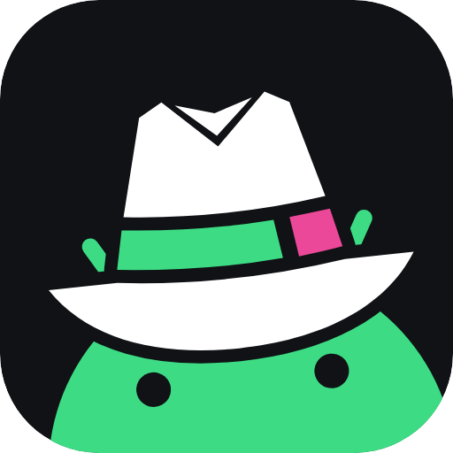



  

<h1 align="center">LycosLane Apps - F-Droid Repository</h1>

  Official signed F-Droid repository for the Pure Suite Android apps. 
  Privacy-first, MIT-licensed open-source software with zero ads, zero accounts, and zero telemetry.

  <a href="https://lycoslane.github.io/fdroid/"><strong>1-Click Add Page</strong></a> &middot;
  <a href="#how-to-install">How to Install</a> &middot;
  <a href="#available-apps">Available Apps</a> &middot;
  <a href="#how-it-works">How It Works</a>

---

## How to Install

### Option 1: Scan QR Code or Use 1-Click Page (Recommended)

Scan this QR code with your Android camera, **F-Droid**, **Droid-ify**, or **Neo Store** to pre-fill the repository URL and signing key fingerprint automatically:

  

If you are browsing directly on your phone without a second screen, open the [**1-Click Add Page**](https://lycoslane.github.io/fdroid/) and tap **Add to Neo Store / F-Droid**.

### Option 2: Manual Repository Setup

1. Install **F-Droid**, **Droid-ify**, or **Neo Store** on your Android device.
2. Open **Settings -> Repositories -> Add repository** and enter:
   * **Repository URL:** `https://lycoslane.github.io/fdroid/repo`
   * **SHA-256 Fingerprint:** `E104F7455B72D8FF7A9F9501B399214AC5AE1FE2707AD3673B638542A66A8397`
   * **Username / Password:** leave empty
   * **Mirror rotation:** leave disabled
3. Refresh your repositories. The client will update the repository name to **LycosLane Apps** and load the repository icon on first sync.

---

## Available Apps

| App | Category | Package ID | Source |
|---|---|---|---|
| **PurePodcast** | Multimedia | `com.lycoslane.purepodcast` | [LycosLane/purepodcast](https://github.com/LycosLane/purepodcast) |
| **PureAudiobooks** | Multimedia | `com.lycoslane.pureaudiobooks` | [LycosLane/pureaudiobooks](https://github.com/LycosLane/pureaudiobooks) |
| **FreeDataDiet Mobile** | System | `com.lycoslane.freedatadiet_mobile` | [LycosLane/freedatadiet-mobile](https://github.com/LycosLane/freedatadiet-mobile) |

### PurePodcast

> **Why PurePodcast:** Most podcast apps lock storage-saving compression behind paid subscriptions, clutter the interface with ads, or lack channel-level audio repair. PurePodcast is 100% free, ad-free, and built purely on native AndroidX/Media3.

- **On-Device AAC Downsampling:** Compress downloaded episodes locally to save mobile storage.
- **Live Audio-Fix DSP:** Fix broken left/right stereo rips on the fly with real-time mono downmix.
- **Local SAF Folders:** Manage local episodes and offline folders without cloud lock-in.

### PureAudiobooks

> **Why PureAudiobooks:** Generic players ignore broken stereo rips, mixed album tags, and speed-adjusted remaining time. PureAudiobooks gives you a calm SAF-folder library with live channel repair, tag splitting, and local sidecar metadata.

- **SAF Folder Library:** Scan and organize your local audiobook directories directly via Storage Access Framework.
- **Live Mono & Channel Repair:** Balance or downmix single-channel recordings during playback.
- **Album-Tag Splitting & Sidecar Metadata:** Keep multi-book folders cleanly separated with local progress and metadata files.

### FreeDataDiet Mobile

> **Why FreeDataDiet Mobile:** Storage cleaners on Play Store are full of ads, trackers, and fake RAM boosters. FreeDataDiet requests zero internet permission, flattens entire folder trees for instant sorting, and verifies duplicates with 2-pass SHA-256.

- **Zero Internet Permission:** 100% offline by design with no telemetry or background network calls.
- **Flattened Tree & Size Treemap:** Spot the largest files across nested folders in seconds.
- **2-Pass SHA-256 Duplicate Finder:** Configurable multi-criteria matching with verified byte-level hashing.

---

## How It Works

This repository is automatically updated daily and on every push to `main` via GitHub Actions:

1. `scripts/sync_releases.py` fetches the latest release APKs and Fastlane metadata (`en-US`, `de-DE`, icons, screenshots, and changelogs) from each upstream GitHub repository.
2. `fdroid update` generates and signs the F-Droid repository index (`index-v1.jar` and `index-v2.json`) using the repository signing key.
3. The landing page (`https://lycoslane.github.io/fdroid/`) and `/repo` directory are published to GitHub Pages.

---

## License

MIT License © 2026 LycosLane

The Android robot in the repository icon is reproduced or modified from work created and shared by Google and used according to terms described in the Creative Commons 3.0 Attribution License.
